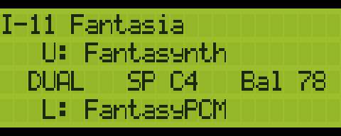
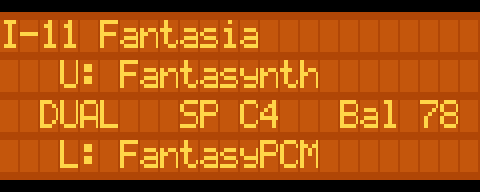

# fm1-d50: a Roland D-50 on the M-VAVE FM-1

fm1-d50 turns the M-VAVE FM-1 into a Roland D-50, the 1987 LA synthesizer. It plays the D-50's own patches with the D-50's partial structure,
PCM waves and effects, from the FM-1's keys or over MIDI.

- The sound is [PicoFaceD5](third_party/picofaced5)'s D-50 engine.
- The platform under it is [fm1-base](https://github.com/charlesvestal/fm1-base).


It is a work in progress. This README describes what works now and will grow with it.

## What works

- **The D-50's sound:**
  - 16 voices at 32 kHz, resampled to the FM-1's 44.1 kHz.
  - Every key mode (Whole, Dual, Split, Separate and their Solo variants), with the D-50's reverb, chorus and EQ.
  - The CPU runs at 396 MHz. A guard fades a voice out before the audio would drop out.
- **Six banks, 384 patches:** the factory card and the PN-D50 card library.
- **Playing:**
  - **Velocity**, from the FM-1's keys.
  - **Aftertouch**, from how hard a held key is pressed.
  - The **bender** and the **modulation**, from MIDI.
  - **Portamento** and the **hold pedal**.
- **Chase Play:** the D-50's echo of a note from one tone to the other.
- **SysEx:** the D-50's DT1 and RQ1 for the current patch and the bank in RAM, so D-50 editors and librarians can read and send patches.
- **The D-50's display:** the LCD of the original, its play screen as a real D-50 shows it.
  - It comes in two views and three colours, described below.

## The screen

HOME steps through three views:

1. **The FM-1 screen**, with the patch, its name and the load. Later this becomes a view that uses the FM-1's screen for the D-50 in its own way.
2. **The LCD at true size:** 2 lines of 40 characters, one pixel a dot. K3 sets the dot height.
3. **The LCD folded:** each line split in two at column 24, at a size that is easy to read.



Hold HOME for 3 seconds to step through the LCD's colours:
- **Green:** an ordinary LCD.
- **Amber** and **blue:** the backlights of real D-50s.




The view and the colour are saved with SAVE.

## The panel

| Control | What it does |
| --- | --- |
| Keys | Play; F3 to G5, with velocity and aftertouch |
| OCT − / OCT + | Octave, −2 to +2 |
| SELECT / PRESET encoders | The patch, through all banks: 1-11 to 6-88 |
| ARP | The D-50's CHASE button: Chase Play on or off |
| HOME | The view; held 3 s, the LCD's colour |
| K1 | The joystick's tone balance: the Upper against the Lower tone (the LCD's Bal) |
| K2 | The joystick's partial balance: partial 1 against partial 2, in both tones |
| K3 | The LCD's dot height (true-size view) |
| SAVE | Saves the patch, bank, octave, view and colour |

The joystick's balances are edits of the current patch, as the edit pages' are: they last until another patch is chosen. On an edit page (EDIT), K1 to K4 are that page's parameters instead.

## MIDI

It receives on every channel, over USB.

| Message | What it does |
| --- | --- |
| Note on and off | Play, with velocity |
| Program change | The patch, 0 to 63, in the bank CC0 chose |
| CC0 | The bank for the next program change, 0 to 5 |
| Pitch bend | The bender, over the patch's range or RPN 0's |
| Channel pressure | Aftertouch |
| CC1 | Modulation |
| CC5, CC65 | Portamento time and switch |
| CC7 | Volume |
| CC64 | Hold pedal |
| CC80 | Chase Play on (64 and up) or off |
| CC100, CC101, CC6 | RPN 0: the bender range |
| CC120, CC123 | All sound off, all notes off |
| SysEx DT1, RQ1 | Roland, model 14h: the temporary area at 00 00 00 and the internal memory at 02 00 00 |

## The D-50 data

The D-50's sound needs its PCM wave ROM, and its patches come from bank dumps (`.syx`). Both are Roland's, so **they are not in this repository and
are never distributed.** Anyone who builds fm1-d50 makes the data from their own ROM and their own banks:

1. `third_party/picofaced5/tools/d5_extract/d5_make_blob.py` makes `d5_pcm.bin` from the ROM.
2. `tools/d50_pack.js` packs it with up to six banks.

```bash
node tools/d50_pack.js roms/gen/d5_pcm.bin roms/out/d50_fm1base.fmd5 --bank bank1.syx --bank bank2.syx
```

A firmware package built with the data is for your own use only.

## Licence

The firmware is GPL-3.0. The engine is [PicoFaceD5](https://github.com/Michi71/PicoVintageSynthCollection) by Michi71, GPL-3.0, used with
its author's agreement ([Michi71/PicoVintageSynthCollection#194](https://github.com/Michi71/PicoVintageSynthCollection/issues/194)).
The platform, [fm1-base](https://github.com/charlesvestal/fm1-base) with felucca-bsp, is MPL-2.0. The fm1-base build links no closed
library: Bluetooth, which would need JieLi's closed libraries, is off. The D-50's data is Roland's and is never part of the firmware or
of this repository.

## Building and installing

**[INSTALL.md](INSTALL.md) is the guide for anyone else:** the emulator in the browser, the firmware from the
[install page](https://mwedmark.github.io/fm1-d50/install/), and the firmware with your own D-50 data.

The firmware is built with fm1-base's tools from the `fm1base/` folder and installed over USB with fm1-base's installer. The steps, the flash
layout and the measurements are in [FM1-BASE.md](FM1-BASE.md).

## More

- [D50.md](D50.md): the D-50 as the target, and the plan
- [RESEARCH.md](RESEARCH.md): what was found out about the D-50, with sources
- [FM1-BASE.md](FM1-BASE.md): fm1-base, the build, and the load of every patch
- [Issues](https://github.com/mwedmark/fm1-d50/issues): what is being worked on

## What is where

- `fm1base/`: the app on fm1-base (the panel, the screen, MIDI, the resampler), its `fm1.toml` and the emulator page (`web/emu/`).
- `d50/`: the glue between the firmware and the engine (`d50.h`, `d50.cpp`), the bank's unpacking, the libm and std headers the toolchain
  lacks, and the 32 to 44.1 kHz resampling filter (`tools/make_resampler.js` writes it).
- `third_party/picofaced5/`: the engine.
- `tools/`: `d50_pack.js` (the data), `d50_host/` (the engine on a PC: renders and tests), `ci/` (the GitHub build).
- `rescue_tools/`: stock firmware back onto an FM-1 that does not start (`fm1_rescue.py`, with M-VAVE's V15, `FM-1_015.fwsc`).

The repository began as a copy of [fm1-sf2](https://github.com/mwedmark/fm1-sf2), the FM-1's SoundFont player, and the D-50 first ran on
M-VAVE's fm1_open SDK there. That build, the SF2 player and its pages and tools were removed when the D-50 moved to fm1-base; `D50.md` and
`FM1-BASE.md` still describe them where they tell the history.
