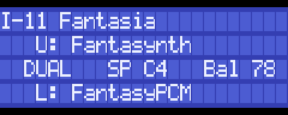

# fm1-d50: en Roland D-50 på M-VAVE FM-1

fm1-d50 förvandlar M-VAVE FM-1 till en Roland D-50, LA-synthen från 1987. Den spelar D-50:ns egna patchar med D-50:ns delton-struktur (partials),
PCM-vågor och effekter, från FM-1:ans tangenter eller över MIDI.

- Ljudet kommer från [PicoFaceD5](third_party/picofaced5)s D-50-motor.
- Plattformen under den är [fm1-base](https://github.com/charlesvestal/fm1-base).


**BYOR: Bring Your Own ROM.** fm1-d50 innehåller ingen Roland-data, och det gör inte heller någon release eller installationssidan. D-50:ns PCM-vågor och
patchbanker kommer från din egen D-50, och du gör en datafil av dem på din egen dator. Det här behöver du ha och göra:

- D-50:ns **PCM-ROM-kretsar** (de två kretsarna på 256 KB, eller de sena korten med en krets på 512 KB) och dess **programminne (EPROM)**, dumpade till filer;
- **en till sex bankdumpar** (`.syx`, en D-50-bulkdump med 64 patchar vardera);
- Python 3 och Node.js samt en utcheckning av det här repot, för att köra två kommandon som skapar datafilen `d50_fm1base.fmd5`.

Stegen, med kretsarnas CRC-32, finns i [INSTALL.md](INSTALL.md). Utan datafilen startar firmwaren och skärmen visar `NO D-50 DATA`.

Det är ett pågående arbete. Den här README:n beskriver det som fungerar nu och växer med det.

## Vad som fungerar

- **D-50:ns ljud:**
  - 16 stämmor vid 32 kHz, omsamplade till FM-1:ans 44,1 kHz.
  - Alla tangentlägen (Whole, Dual, Split, Separate och deras Solo-varianter), med D-50:ns reverb, chorus och EQ.
  - Processorn går på 396 MHz. En vakt tonar ut en stämma innan ljudet skulle hacka.
- **Sex banker, 384 patchar:** fabrikskortet och PN-D50-kortbiblioteket.
- **Spela:**
  - **Anslagsstyrka (velocity)**, från FM-1:ans tangenter.
  - **Eftertryck (aftertouch)**, från hur hårt en nedhållen tangent trycks.
  - **Pitchbend** och **modulation**, från MIDI.
  - **Portamento** och **hållpedal**, med patchens Portamento Mode och Hold Mode (U, L eller båda) som på en D-50: i split- och
    separate-lägena håller pedalen bara de toner som Hold Mode anger.
- **Chase Play:** D-50:ns eko av en not från en ton till den andra.
- **SysEx:** D-50:ns DT1 och RQ1 för aktuell patch och banken i RAM, så att D-50-editorer och bibliotekarier kan läsa och skicka patchar.
- **D-50:ns display:** originalets LCD, med spelskärmen som en riktig D-50 visar den.
  - Den finns i två vyer och tre färger, beskrivna nedan.

## Skärmen

Vid start visar skärmen D-50:ns startmeddelande i två sekunder, alltid i LCD:n i sann storlek och oavsett vald vy:
`******  Linear Synthesizer  D-50  ******` över `Roland Corporation`, som i D-50:ns bruksanvisning. Därefter följer den valda vyn.

HOME stegar genom tre vyer:

1. **FM-1-skärmen**, med patchen, dess namn och belastningen. Senare blir detta en vy som använder FM-1:ans skärm för D-50 på dess eget sätt.
2. **LCD:n i sann storlek:** 2 rader med 40 tecken, en pixel per punkt. K3 ställer in punkthöjden.
3. **LCD:n vikt:** varje rad delad i två vid kolumn 24, i en storlek som är lätt att läsa.


Håll HOME i 3 sekunder för att stega genom LCD:ns färger:
- **Grön:** en vanlig LCD.
- **Bärnsten (amber)** och **blå:** bakgrundsbelysningen hos riktiga D-50:or.




Vyn och färgen sparas med SAVE.

## Panelen

| Kontroll | Vad den gör |
| --- | --- |
| Tangenter | Spela; F3 till G5, med velocity och eftertryck |
| OCT − / OCT + | Oktav, −2 till +2 |
| SELECT- / PRESET-vredet | Patchen, genom alla banker: 1-11 till 6-88 |
| ARP | D-50:ns CHASE-knapp: Chase Play på eller av |
| HOME | Vyn; hållen 3 s, LCD:ns färg |
| K1 | Joystickens X, som på en D-50: vald tons delton-balans, delton 1 mot delton 2 |
| K2 | Joystickens Y, som på en D-50: tonbalansen, den övre mot den nedre tonen (LCD:ns Bal) |
| K3 | LCD:ns punkthöjd (vyn i sann storlek) |
| K4 | Vald ton för K1 och för EQ- och Chorus-sidorna, som D-50:ns UPPER- och LOWER-knappar: höger Lower, vänster Upper (Upper vid start) |
| SEL | D-50:ns TUNE/FUNCTION-sida, och tillbaka: K1 Master Tune (427,5 till 452,6 Hz i 100 steg, först 440,0), K2 Key Transpose (−12 till +12): bara FM-1:ans tangenter, som på en D-50; toner från MIDI flyttas inte. Båda sparas med SAVE, som D-50:n behåller dem över en strömcykel; en Master Tune från MIDI (RPN 1) sparas inte, som på en D-50 |
| EDIT | Redigeringssidorna i tur och ordning (Output Mode, Chase, EQ, Chorus, MIDI Channel: BasicCH, Omni, Control, Local; Data Transfer, nedan; FM-1 Setup, nedan), sedan spelskärmen |
| SAVE | Sparar patchen, banken, oktaven, vyn, färgen, MIDI-inställningarna, Master Tune och Key Transpose samt sidan FM-1 Setup; och bank 1, när SysEx har ändrat den och den ännu inte är sparad (nedan). Hållen 2 s: WRITE (nedan) |

Joystickens balanser är ändringar av aktuell patch, liksom redigeringssidornas: de gäller tills en annan patch väljs. På en redigeringssida (EDIT) är K1 till K4 i stället den sidans parametrar.

**EQ** och **Chorus** redigerar den valda tonen (K4 på spelskärmen; sidans översta rad säger Upper eller Lower), med D-50-firmwarens egna sidor:
EQ `Lf Lg Hf HQ Hg` (låg frekvens 63 till 840 Hz, dess förstärkning −12 till +12, hög frekvens 250 Hz till 9,5 kHz, dess Q 0,3 till 6,0 samt förstärkning), och
Chorus `Type Rate Dpth Bal` (typ 1 till 8, övriga 0 till 100). EQ har fem värden på fyra rattar: K1 flyttar markören (ett streck under värdet),
K2 ändrar värdet ovanför. Chorus är K1 till K4, från vänster till höger. WRITE sparar dem med patchen.

## MIDI

Den tar emot och skickar över USB. Sidan **MIDI Channel** (EDIT) har D-50:ns inställningar, sparade med SAVE:

- **BasicCH** (K1), 1 till 16, standard 1: kanalen den spelar på med omni av, och dess SysEx-enhets-ID, som på en D-50 (enhets-ID är
  baskanalen minus ett: kanal 1 är `00`).
- **Omni** (K2), standard ON: ON spelar alla kanaler, som förut; OFF bara baskanalen.
- **Control** (K3), D-50:ns MIDI-1-inställning, standard B.CH: kanalen som programbyte, eftertryck och kontroller kommer in på i
  monoläget (nedan). B.CH är baskanalen och G.CH den globala kanalen, den under den. MdeOff ignorerar Mono och Poly, och att välja det
  avslutar monoläget.
- **Local** (K4), standard ON, som på en D-50: OFF låter FM-1:ans tangenter bara skickas (nedan), inte låta, för att spela ett annat instrument eller en DAW.
  Deras eftertryck skickas också bara. Vreden skickar då ett programbyte utan att byta patch (skärmen säger PROG OUT); MIDI
  in spelar som alltid. CC 122 på baskanalen sätter det (0 av, 127 på). Att slå av det avslutar de toner tangenterna låter.

**Vad den skickar**, som en D-50, på patchens **TxCH** (en patchinställning: B, baskanalen, eller 1 till 16):

- **Tangenterna:** note-on med velocity och note-off (som velocity 0), flyttade av Key Transpose. När sista tangenten släpps skickas CC 123 All Notes Off.
- **Eftertryck**, från hur hårt en nedhållen tangent trycks.
- **Ett programbyte** (0 till 63, i banken) när en patch väljs med vreden, men inte när MIDI valde den.
- **När TxCH ändras** med en ny patch: de nedhållna tangenternas note-off och All Notes Off på den gamla kanalen, sedan CC 124 Omni Off och CC 127 Poly på den nya.

Joysticken (K1, K2) skickas inte, eftersom en D-50:s inte gör det. FM-1 har ingen egen pitchbend, hävarm eller pedaler att skicka.

**Monoläget** (CC 126 på baskanalen, med omni av), som på en D-50: värdet är antalet kanaler, från baskanalen
och uppåt (0 och 9 till 16 ger 8, och inte längre än kanal 16). Varje kanal är en egen monofonisk stämma, med egen pitchbend, oavsett
patchens tangentläge: en ny not på en kanal avslutar den kanalens senaste. Det är till en MIDI-gitarr, en kanal per sträng, eller en sekvenser-
stämma per kanal. Med omni på spelar Mono polyfont. **CC 127 (Poly)** avslutar det; från då spelar även Solo-tangentlägena (Whole-S, Dual-S,
Split-US och så vidare) polyfont, som på en D-50, tills Mono eller MdeOff. Var och en stänger av tonerna. Läget sparas inte över en
strömcykel (inte heller en D-50:s); skärmen säger MONO eller POLY.

**Separate-tangentlägena** (SEP och SEP-S), som på en D-50: FM-1:ans tangenter och baskanalen spelar patchens Lower-ton,
polyfont. Patchens egen SepCH (en patchinställning, OFF eller 1 till 16) spelar Upper: polyfont i SEP, en not i taget i SEP-S. Varje
ton har egen pitchbend, modulation, eftertryck, portamento och hållpedal. SepCH tar noter, pitchbend, eftertryck och CC 1, 5, 6, 64, 65,
98 till 101 och 123, men ingen volym och inget programbyte. Som på en D-50 går ett meddelande på SepCH också genom baskanalens test, så med
omni på (eller SepCH som baskanalen) spelar det båda tonerna. Med SepCH OFF låter bara Lower. Ingen av de sex bankerna har en sådan patch;
en bibliotekarie kan göra en.

| Meddelande | Vad det gör |
| --- | --- |
| Note on och off | Spela, med velocity |
| Programbyte | Patchen, 0 till 63, i banken som CC0 valde |
| CC0 | Banken för nästa programbyte, 0 till 5 |
| Pitch bend | Pitchbend, över patchens omfång eller RPN 0:s |
| Channel pressure | Eftertryck |
| CC1 | Modulation |
| CC5, CC65 | Portamento-tid och -brytare |
| CC7 | Volym |
| CC64 | Hållpedal |
| CC80 | Chase Play på (64 och uppåt) eller av |
| CC81 | Joystickens tonbalans (K2, Y): 0 till 127 över 0 till 100, den övre mot den nedre tonen. Vår egen: D-50:n har ingen kontroller för det |
| CC82 | Joystickens deltonbalans (K1, X): 0 till 127 över 0 till 100, för den valda tonen (K4). Vår egen |
| CC100, CC101, CC6, CC38 | RPN 0: pitchbend-omfånget (upp till 12). RPN 1, Fine Tuning: Master Tune, som på en D-50, när båda dataentry-byten har kommit (mitten är 440,0 Hz, ungefär ±50 cent över halva omfånget; TUNE/FUNCTION-sidan visar det) |
| CC98, CC99 | En NRPN: dataentryna efter den tas inte emot, tills nästa RPN |
| CC120, CC123 | All sound off, all notes off |
| CC122 | Local, som på en D-50: 0 av, 127 på, på baskanalen (ovan) |
| Active Sensing (FE) | Som på en D-50: efter en FE avslutar cirka 0,7 s utan någon MIDI alls tonerna och sätter pitchbend, hävarm, eftertryck, volym, pedal och RPN tillbaka i viloläge (skärmen säger SENSING LOST), tills nästa FE |
| CC124, CC125 | Omni off, omni on, som på en D-50: bara på baskanalen och med värdet 0. De sätter MIDI Channel-sidans Omni (sparas med SAVE) och stänger av tonerna |
| CC126, CC127 | Mono (värdet: kanalerna) och Poly (värde 0), som på en D-50: bara på baskanalen, inte med Control MdeOff (ovan) |
| SysEx DT1, RQ1 | Roland, modell 14h: det temporära området på 00 00 00 och det interna minnet på 02 00 00 (nedan) |

## SysEx

**D-50:ns egen** (`F0 41 dev 14 ...`, Roland, modell 14h), åt båda hållen som D-50:ns Data Transfer-meny har: enkelriktat ("Bulk Dump.O",
"Bulk Load.O") och med handskakning ("Bulk Dump", "Bulk Load").

Enkelriktat:

| Meddelande | Vad det gör |
| --- | --- |
| DT1 (`12`) | Skriver data på en adress; kontrollsumman kontrolleras. |
| RQ1 (`11`) | Läser data från en adress; FM-1 svarar med DT1 på upp till 256 byte, ett i taget allteftersom datorn läser. |

Med handskakning (Rolands dåtida protokoll; ännu inte prövat mot en riktig D-50 eller en bibliotekarie):

| Meddelande | Vad FM-1 gör |
| --- | --- |
| WSD (`40`, adress, storlek) | Svarar ACK: datorn får skicka. |
| DAT (`42`, adress, data) | Skriver datan som en DT1 gör och svarar ACK; ERR när kontrollsumman är fel (datorn skickar igen). |
| EOD (`45`) | Svarar ACK: överföringen är klar. |
| RQD (`41`, adress, storlek) | Skickar datan som DAT på upp till 256 byte, var och en efter datorns ACK på den förra, sedan EOD; RJC när inget finns på den adressen. |
| ACK (`43`), ERR (`4E`), RJC (`4F`) | Från datorn: nästa DAT, den senaste igen, eller stopp. |

Utan D-50-data i FM-1 besvaras WSD och RQD med RJC.

| Adress | Vad det är |
| --- | --- |
| `00 00 00` | Det temporära området: aktuell patchs 448 byte (övre delton 1 och 2, common, nedre delton 1 och 2, common, patch; 64 byte vardera). En DT1 eller DAT här ändrar ljudet direkt. En byte över sin parameters maximum hoppas över, som på en D-50 (resten av meddelandet skrivs). |
| `02 00 00` | Det interna minnet: den valda banken, 448 byte per patch (64 patchar, upp till `03 60 00`). Bank 1 (skärmens I) är D-50:ns interna minne och sparas i flashminnet (nedan); på en annan bank (ett kort, C) varar det som skrivs tills en annan bank väljs. |
| `03 60 00` | Reverb-datan i en bulkdump, till `04 0E 7F` (en nibble per byte: D-50:ns reverbtyper 17 till 32 för dess reverbkrets). Sparas som D-50:n sparar den och skickas tillbaka, efter patcharna när hela minnet efterfrågas (`02 00 00`, storlek `02 0F 00`), så att en bibliotekariedump som läses tillbaka från FM-1 är hel. FM-1:ans reverb är en modell och använder den inte. På bank 1 sparas den i flashminnet med patcharna; på ett kort tills en annan bank väljs. |
| Allt annat | Tas emot och ignoreras. D-50:n har inget annat område i SysEx: inget systemområde, eftersom dess MIDI- och funktionsinställningar inte nås med SysEx. |

FM-1 tar emot och besvarar bara D-50-meddelanden för sitt eget enhets-ID (baskanalen minus ett, sidan MIDI Channel); den svarar
med det ID:t. Ett felaktigt meddelande visar sitt fel på skärmen (fel format, kontrollsumma eller adress).

Där FM-1 skiljer sig från en D-50 (docs/D50-FIRMWARE.md):

- Den tar emot mer: det interna minnet och handskakningen när som helst, åt båda hållen, där en D-50 tar dem bara på sin Data Transfer-skärm i
  den riktning som väljs där, och aldrig besvarar en RQ1 där. Den tar också emot fler än 256 databyte i ett meddelande.
- Den är strängare med en felaktig kontrollsumma: ingenting skrivs, där en D-50 redan har skrivit datan.
- Den har ingen Exclu-brytare (all SysEx tas alltid emot) och inget minnesskydd.
- Den har inget kortminne i SysEx: D-50:ns kortposter i Data Transfer-menyn har ingen motsvarighet, och FM-1:ans övriga banker (C) nås inte med adress. `02 00 00` är den bank som är vald.
- Den startar en dump själv från Data Transfer-sidan (nedan), som D-50:n gör från sin meny; en dator får också begära en (RQ1, RQD) när som helst.

**Data Transfer** (EDIT-sidan efter MIDI Channel), D-50:ns egen meny för en bibliotekarie som väntar på att synthen ska börja, som D50 Librarians nedladdning gör. K1 väljer post, SAVE startar den (som D-50:ns Enter; på den här sidan sparar SAVE inte inställningarna), och att lämna sidan (EDIT, SEL) avslutar en pågående överföring. Posterna är D-50:ns, för hela det interna minnet (`02 00 00`: banken i RAM, med reverb-datan när en dump har fört in den):

| Post | Vad FM-1 skickar |
| --- | --- |
| Bulk Dump | WSD, sedan en DAT på 256 byte på var och en av datorns ACK, sedan EOD. Starta bibliotekariens mottagning först, sedan det här. |
| Bulk Load | RQD; datorn svarar med sin WSD och DAT (när som helst, de tas emot som alltid). |
| Bulk Dump.O | DT1 på 256 byte enkelriktat, hela minnet. Starta bibliotekariens mottagning först. |
| Bulk Load.O | Ingenting: DT1 tas emot som alltid. |

Bulk Dump och Bulk Dump.O skickar alltid D-50:ns egen storlek (`02 0F 00`); utan reverb-data i FM-1 (ingen har någonsin laddats av en dump) går den delen ut som nollor, så att en bibliotekarie som väntar sig hela minnet tar emot den. Skärmen säger Complete . när det är klart, och Error Reject när datorn gav upp (RJC) eller bad om något annat. Prövat med D50 Librarian (bara enkelriktat: Bulk Dump.O och Bulk Load.O, ärende #51); inte mot en riktig D-50. D-50:ns kortposter har ingen motsvarighet.

**Bank 1 sparas**, som en D-50 sparar sitt interna minne: det SysEx skriver i den (patcharna på `02 00 00` och reverb-datan) sparas
i flashminnet och finns kvar efter en strömcykel, en uppdatering och ny D-50-data. Fram till första sparningen är det fabriksbanken i din datafil.
De andra bankerna är kort: det som skrivs i en varar tills en annan bank väljs.

- **Store Auto** (standard): den sparas av sig själv när SysEx har varit tyst i 1,5 sekunder efter sin sista skrivning i bank 1 (och ingen
  Data Transfer pågår), så att en hel dump sparas en gång. Skärmen säger SAVING, sedan SAVED och Complete . på LCD:n.
- **Store SAVE**: den sparas bara när du trycker på SAVE (SAVE-knappen lyser medan det finns något att spara). Om du väljer en annan bank först
  förloras det som inte sparats.

En sparning tar ungefär en sekund; nedhållna toner avslutas när den börjar. Den skriver flashminnet i två kopior, varje gång den äldre, så att en avbruten sparning
(strömmen, en ny SysEx-skrivning) lämnar den förra kvar.

**FM-1 Setup** (EDIT-sidan efter Data Transfer): FM-1:ans egna inställningar, som en D-50 inte har; sparas med SAVE. K1 är **Store**, Auto eller
SAVE (ovan). K2 är **Voices**, polyfonitaket: varje tons stämmor som mest, 1 till 16 (16 vid start, D-50:ns eget: 16 toner i Whole, 8 per
ton i de andra tangentlägena). Det gäller över ett programbyte; stämmor över ett lägre tak låter vidare till sin release. CPU-vakten, som tar bort en
stämma när belastningen är för hög, går aldrig över det. K3 är **VCrv**, velocity-kurvan för FM-1:ans tangenter, -5 till +5 (0 vid start, som
uppmätt): + kräver ett hårt anslag för de högsta velocityvärdena, - når dem med mindre. Den verkar på de 20 avkända tangenterna (F3 till C5); den
översta radens tangenter och MIDI in behåller sin velocity.

**WRITE**, som D-50:ns: **SAVE hållen 2 sekunder** skriver aktuell patch, med dess ändringar (redigeringssidornas, joystickens, SysEx in i det
temporära området `00 00 00`), på sin egen plats i bank 1 (I-11 .. I-88), och bank 1 sparas i flashminnet direkt, oavsett Store. Skärmen
säger WRITE I-xy, SAVING, sedan SAVED, och LCD:n Complete . Ett kort tryck på SAVE sparar inställningarna som förut, när den släpps. Bara bank 1:
på ett kort säger skärmen ONLY TO BANK I (korten är skrivskyddade).

**För mätning** (`F0 7D 'S' 'F' 02 ... F7`, sex byte):

| Kommando | Vad det gör |
| --- | --- |
| `0B` | Läser belastningen: vart tiden går, CPU-belastningen och dess topp, stämmorna, kärnorna och de missade ljudblocken. |
| `0C bits` | Utelämnar reverb (1), chorus (2) eller EQ (4), för att se vad var och en kostar. |
| `0D c` | Läser vilken SysEx som kom in: de ramar som nådde D-50 och deras DT1, de F0, F7 och byte som USB-avbrottet såg, och vid vilken av det interna minnets 136 platser på 256 byte en DT1 började, både som appen fick dem och som avbrottet såg dem (ärende #84). `c` 1 startar om räknarna. |
| `0E 00` | Läser de senaste 32 DT1 som nådde D-50, äldst först: varje adress, antal databyte och första databyte (ärende #51: vad en bibliotekarie eller en editor skickar). |

**Från plattformen** ([fm1-base](https://github.com/charlesvestal/fm1-base)): uppdateringen av firmwaren och D-50-datan, säkerhetskopiering och återställning, och följeslagarens tjänster.
[Installationssidan](https://mwedmark.github.io/fm1-d50/install/) och fm1-bases verktyg använder dem; musikprogram behöver dem inte.

## D-50-datan

D-50:ns ljud behöver dess PCM-vågminne, och dess patchar kommer från bankdumpar (`.syx`). Båda är Rolands, så **de finns inte i det här repot och
distribueras aldrig.** Den som bygger fm1-d50 gör datan av sitt eget ROM och sina egna banker:

1. `third_party/picofaced5/tools/d5_extract/d5_make_blob.py` gör `d5_pcm.bin` av ROM:et.
2. `tools/d50_pack.js` packar den med upp till sex banker.

```bash
node tools/d50_pack.js roms/gen/d5_pcm.bin roms/out/d50_fm1base.fmd5 --bank bank1.syx --bank bank2.syx
```

Ett firmwarepaket byggt med datan är bara för eget bruk.

## Licens

Firmwaren är GPL-3.0. Motorn är [PicoFaceD5](https://github.com/Michi71/PicoVintageSynthCollection) av Michi71, GPL-3.0, använd med
upphovsmannens medgivande ([Michi71/PicoVintageSynthCollection#194](https://github.com/Michi71/PicoVintageSynthCollection/issues/194)).
Plattformen, [fm1-base](https://github.com/charlesvestal/fm1-base) med felucca-bsp, är MPL-2.0. Bygget av fm1-base länkar inget slutet
bibliotek: Bluetooth, som skulle kräva JieLis slutna bibliotek, är avstängt. D-50:ns data är Rolands och ingår aldrig i firmwaren eller
i det här repot.

## Bygga och installera

**[INSTALL.md](INSTALL.md) är guiden för alla andra:** emulatorn i webbläsaren, firmwaren från
[installationssidan](https://mwedmark.github.io/fm1-d50/install/), och firmwaren med din egen D-50-data.

Firmwaren byggs med fm1-bases verktyg från mappen `fm1base/` och installeras över USB med fm1-bases installationsprogram. Stegen, flashminnets
layout och mätningarna finns i [FM1-BASE.md](FM1-BASE.md).

## Mer

- [D50.md](D50.md): D-50:n som mål, och planen
- [RESEARCH.md](RESEARCH.md): vad som har tagits reda på om D-50:n, med källor
- [FM1-BASE.md](FM1-BASE.md): fm1-base, bygget och belastningen för varje patch
- [Ärenden](https://github.com/mwedmark/fm1-d50/issues): vad som arbetas med

## Vad som finns var

- `fm1base/`: appen på fm1-base (panelen, skärmen, MIDI, omsamplaren), dess `fm1.toml` och emulatorsidan (`web/emu/`).
- `d50/`: limmet mellan firmwaren och motorn (`d50.h`, `d50.cpp`), bankens uppackning, de libm- och std-huvuden som verktygskedjan
  saknar, och omsamplingsfiltret 32 till 44,1 kHz (`tools/make_resampler.js` skriver det).
- `third_party/picofaced5/`: motorn.
- `tools/`: `d50_pack.js` (datan), `d50_host/` (motorn på en PC: renderingar och tester), `ci/` (bygget på GitHub).
- `rescue_tools/`: originalfirmware tillbaka på en FM-1 som inte startar (`fm1_rescue.py`, med M-VAVE:s V15, `FM-1_015.fwsc`).

Repot började som en kopia av [fm1-sf2](https://github.com/mwedmark/fm1-sf2), FM-1:ans SoundFont-spelare, och D-50:n gick först på
M-VAVE:s fm1_open SDK där. Det bygget, SF2-spelaren och dess sidor och verktyg togs bort när D-50:n flyttade till fm1-base; `D50.md` och
`FM1-BASE.md` beskriver dem fortfarande där de berättar historien.
